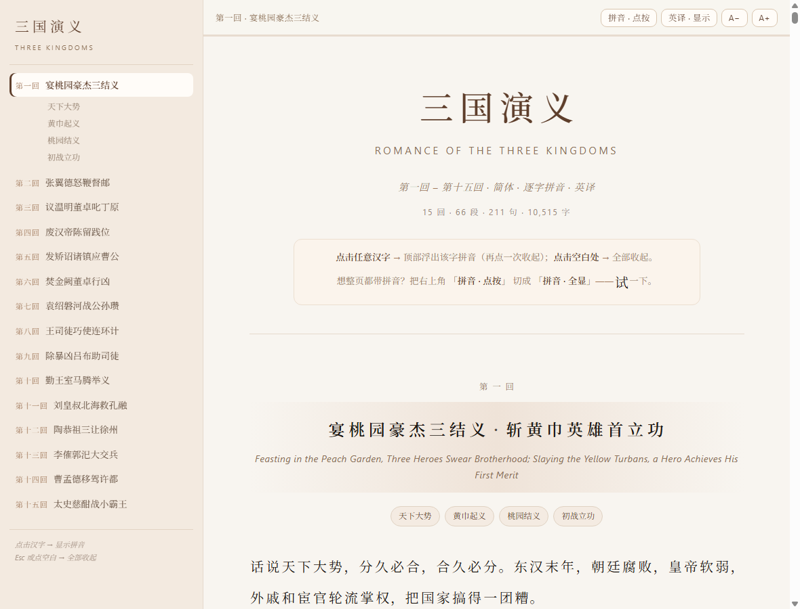

# 三国演义 · Romance of the Three Kingdoms

逐字拼音 + 英译的《三国演义》电子书。单文件、离线可读，一个 HTML 就是整本书。

**在线阅读 → https://chxyin.github.io/theromanceofthreekingdoms/**



## 打开

双击 `三国演义.html`，或拖进浏览器。不需要联网，不需要安装任何东西。

## 功能

- **点击任意汉字** → 字上方浮出该字拼音，再点一次收起；**点击空白处** → 全部收起
- **「悬停」** → 鼠标指到哪个字就读哪个字（默认关闭，与点按共用同一套拼音气泡）
- **「拼音 · 全显」** → 整页拼音以注音形式排在每个字上方，适合通读
- **英译** 可随时显示 / 隐藏
- **字号** A− / A+，自动记住
- **左侧目录**：回目 + 小节，自动高亮当前回，并记住上次读到哪儿
- 手机端为抽屉式目录；`Esc` 收起拼音；自带打印样式

## 收录范围

**第一回 – 第十五回**（全，无缺回）。

15 回 · 66 段 · 211 句 · 10,515 字，每个字都带拼音。

正文是白话改写版：句子更短、词汇更宽，适合逐字认读。

## 文件

| 文件 | 说明 |
| --- | --- |
| `index.html` | GitHub Pages 入口，内容与 `三国演义.html` 完全相同 |
| `三国演义.html` | 成品，自包含（样式、脚本、数据全部内联） |
| `ch*.html` | 各回源文件，拼音数据就在这里 |
| `rtk-build.js` | 把 `ch*.html` 合成成品 |
| `rtk-style.css` | 样式表，构建时内联进去 |
| `rtk-client.js` | 阅读交互，构建时内联进去 |
| `rtk-check.js` | 校验：拼音完整性、锚点、原文一致性 |
| `预览.png` | 截图 |

## 重新生成

```bash
node rtk-build.js    # 自动收录本目录所有 chN.html，输出 三国演义.html
node rtk-check.js    # 校验拼音 / 链接 / 与原文逐字比对
```

补上后续回目（`ch16.html` …）后重跑即可，目录会自动收录。

## 拼音校对

每一处标音都用 `pypinyin` 校验过：一个字的标音必须是该字可能的读音之一，否则判为错误。
全稿订正 83 处误读（如 才 ái→cái、此 zǐ→cǐ、心 xiīn→xīn、血 xuě→xuè），
轻声与儿化（明白 bai、便宜 yi、东西 xi、弟弟 di、儿 r）按正确读音保留。

## 源文件格式

每回是一个独立 HTML，核心是一个 `SENTENCES` 数组。`zh` 是以空格分隔的 token 串：

| 写法 | 渲染结果 |
| --- | --- |
| `字\|pīnyīn` | 可点击的 `.word`，点击显示拼音 |
| `RAW…` | 原样输出 |
| 其余（标点） | `.punct` |

拼音是逐字标注的数据，不是程序生成的；构建脚本只做搬运和排版，不改动任何字词。

## 说明

- 正文与源文件逐字一致（`rtk-check.js` 会做全文字符比对）。
- 源文件里粘在字上的标点（如 `，朝|cháo`）在构建时被拆开，避免标点变成可点字、或跑到行首。
- 标点与它前面的字绑定，不会出现在行首。
